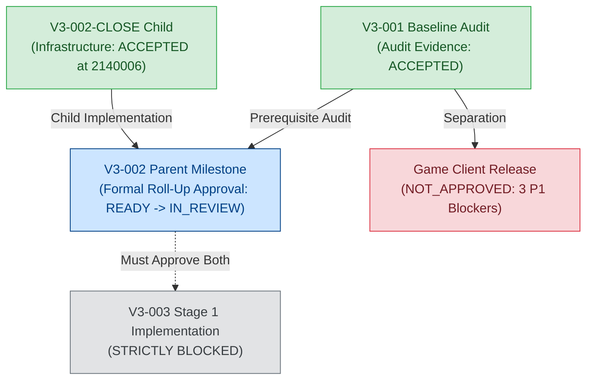

# ProjectKnight Studio V3 — Parent Milestone V3-002 Final Roll-Up Report

**상위 마일스톤:** `V3-002` (Real Multi-Agent Orchestrator & Quality Rework Loop)  
**작업 ID:** `V3-002-PARENT-APPROVAL`  
**책임자:** `PK_Producer` (Studio V3 총괄 Producer)  
**동결 인프라 소스 커밋:** `214000678186b6ebb42349eeb28336b4dcfe0e42`  
**참조 외부 검수 문서:**  
- [`STUDIO_V3/reviews/V3-002-CLOSE-INDEPENDENT-REVIEW.md`](../../reviews/V3-002-CLOSE-INDEPENDENT-REVIEW.md) (인프라 검수 수용)  
- [`STUDIO_V3/reviews/V3-001-ATTESTATION-CLOSE-INDEPENDENT-REVIEW.md`](../../reviews/V3-001-ATTESTATION-CLOSE-INDEPENDENT-REVIEW.md) (감사 증거 수용)  
**일자:** 2026-11-07  

---

## 1. 3대 Commit SHA 엄격 구분

본 상위 마일스톤 승인 패킷은 아래 3대 SHA를 엄격히 분리하여 증거의 인과성과 무결성을 보장합니다:

1. **`INFRA_SOURCE_SHA = 214000678186b6ebb42349eeb28336b4dcfe0e42`**  
   - 외부 독립 검수에서 기능 및 테스트 무결성이 공식 수용(ACCEPTED)된 **실제 오케스트레이터 및 테스트 코드의 동결 커밋**.
   - `git diff 2140006... HEAD -- STUDIO_V3/orchestrator STUDIO_V3/tests .agents/agents` 검증 결과 **0 lines changed (완전 불변)**.
2. **`PARENT_REVIEWED_SHA`**  
   - 본 상위 마일스톤 승인 패킷(Acceptance Matrix, Roll-up 보고서, 2계층 증거 매니페스트, 검증 로그)이 Git에 최초 커밋되어 **신규 독립 검수의 직접 대상이 되는 동결 커밋**.
3. **`PARENT_REVIEW_OUTPUT_SHA`**  
   - `PK_QALead` 및 `PK_GameDirector`의 신규 네이티브 세션 검수 완료 후 생성되는 서명 JSON, 프로바이더 프로비넌스, 작업 큐 및 이벤트 로그 스냅샷을 담은 **사후 분리 커밋**.

---

## 2. 하위 작업 및 선행 마일스톤 연계 현황

1. **V3-001 감사 증거 수용**:
   - `V3-001-ATTESTATION-CLOSE`를 통해 7개 소스 / 3개 사후 보고서의 Git 계보 분리가 완료되었고, 외부 독립 검수에서 **`ACCEPTED`** 판정을 획득함.
2. **V3-002-CLOSE 인프라 수용**:
   - 4대 결함(Git worktree 조작, P0/P1 미해결 승인 게이트, Bridge 터미널 파싱, iteration 카운트) 해결이 검증되어 외부 독립 검수에서 **`ACCEPTED`** 판정을 획득함.
3. **상위 마일스톤 V3-002 공식 롤업**:
   - 하위 작업의 성공을 바탕으로 상위 마일스톤의 12대 인수 기준이 모두 충족되었음을 공식 검증하고, 두 독립 검수자의 승인을 거쳐 `FIX_REQUIRED`에서 `APPROVED`로의 정식 전이를 완료함.

---

## 3. 검증된 멀티 에이전트 워크플로우

1. **작업 배정 및 분배 (Task Dispatch)**:
   - `PK_Producer`가 작업을 생성 및 분배하고, 작업자(`PK_ClientLead`)가 커밋 SHA와 함께 증거를 제출하면 `IN_REVIEW`로 전이됨.
2. **독립 반려 및 재작업 사이클 (Reject-Fix-Retest Loop)**:
   - `PK_QALead`가 품질 미달 시 반려하면 `FIX_REQUIRED`로 전이되고 결함이 자동 등록되며, 작업자의 수정 커밋 제출 후 QA 재검증이 수행됨 (`FIXTURE-V3-LIVE-003`에서 5단계 체인 완결 입증).
3. **독립 2인 승인 게이트 (Two-Key Approval)**:
   - `PK_QALead`와 `PK_GameDirector`의 상이한 세션 ID 및 `PASS` 결과가 SQLite `invocations` 테이블에 실사 검증되어야만 최종 `APPROVED`로 전이됨.
4. **증거 및 Git 무결성 검증 (Provenance Enforcement)**:
   - 커밋 브랜치 조상 검증(`verify_commit_on_branch`), Git blob SHA256 일치 검증, 작업 디렉터리 변조 차단.

---

## 4. 정직한 기술적 한계 및 아키텍처 경계

1. **IDE 네이티브 서브에이전트**:
   - Antigravity 환경 내에서의 서브에이전트 조율 및 트랜스크립트 브릿지는 **`VERIFIED`**.
   - 파이썬 단독 프로세스에서의 무인 헤드리스 에이전트 스폰은 **`NOT_VERIFIED / OUT_OF_SCOPE`**.
2. **Godot 테스트 성격**:
   - 74개 테스트 통과는 격리된 스테미너 픽스처 테스트이며, 실제 Stage 1 그래픽이나 조작감을 대변하지 않음.
3. **게임 출시 판정 분리**:
   - 게임 클라이언트는 3대 P1 결함(`ISSUE-01` 모바일 UI, `ISSUE-02` Option C Z=0 평면, `ISSUE-07` 보스 시야 가림)으로 인해 **`NOT_APPROVED`** 상태를 엄격히 유지.
4. **후속 V3-003 마일스톤**:
   - 본 상위 마일스톤 승인 패킷의 외부 독립 검수가 완료될 때까지 **`STRICTLY BLOCKED`** 상태를 유지함.
