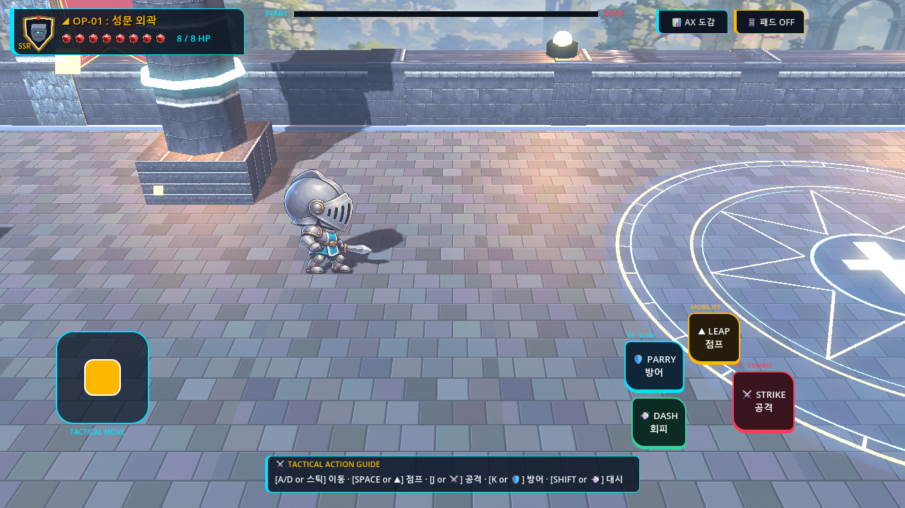
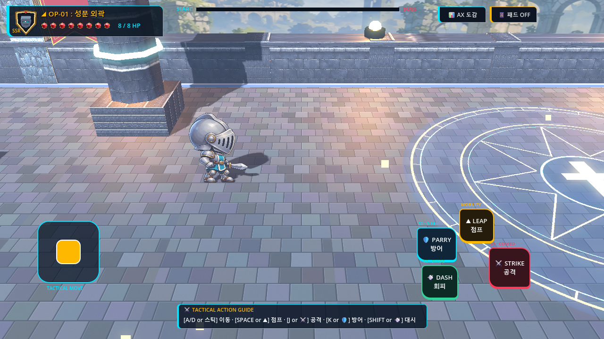
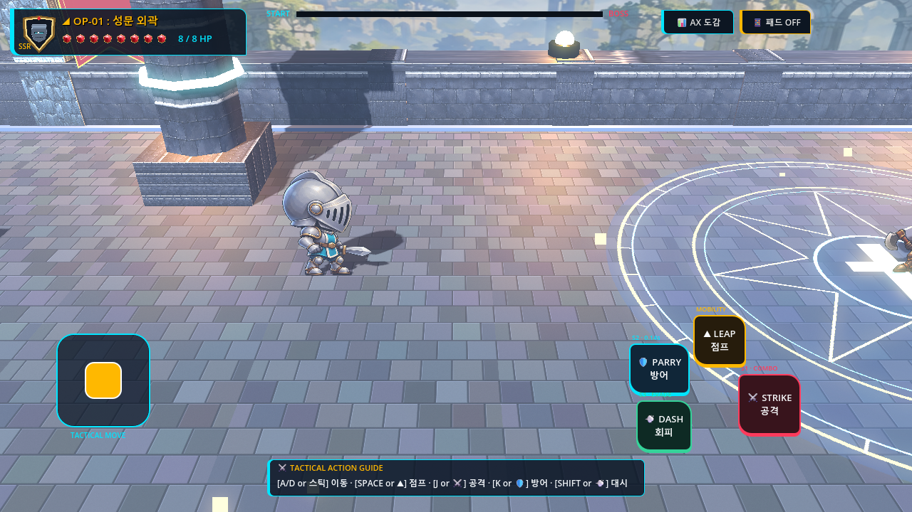
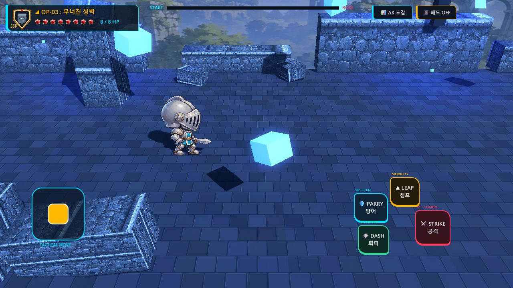
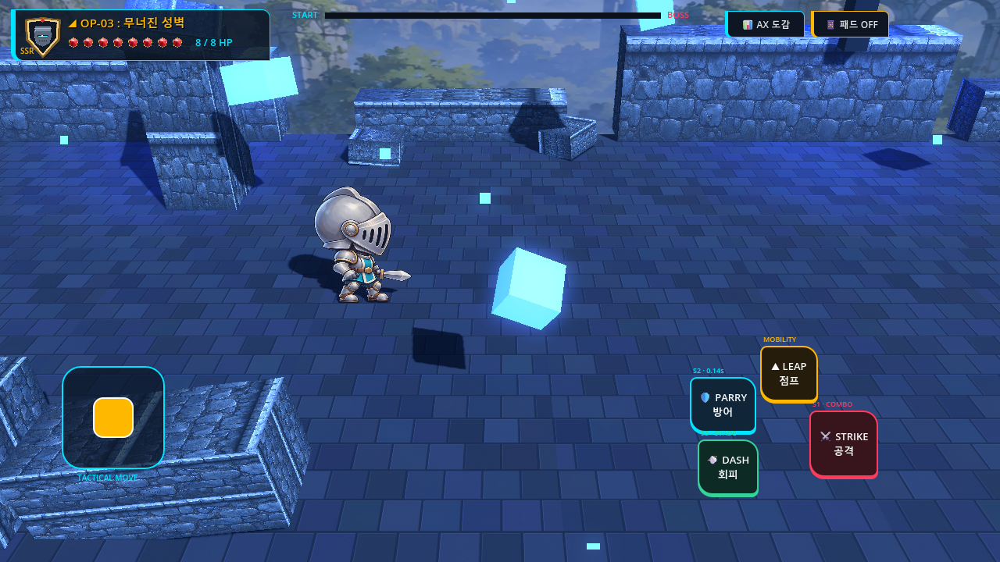
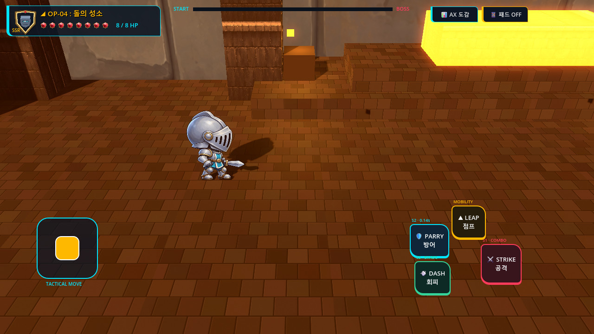

# V3-012 Before vs After Visual & Encounter Readability Comparison

## Milestone Scope & Quality Target
Milestone **V3-012** focused on **Encounter Combat Readability & Enemy Reaction Polish**:
1. Confirmed hit reactions distinguishing standard strikes (white-hot flash + 2.2 m/s recoil) vs counter/crit strikes (cyan-gold radiant flash + 3.6 m/s recoil).
2. Readable enemy death transitions: immediate collision de-registration, attack monitoring disabled, single atomic `enemy_defeated` signal emission, overhead HP bar hidden, and upward dissolve with expanding spark torus ring.
3. Accurate attack danger telegraphs: Stage 3 Crossbow Commander 3-way fan volley projecting all 3 trajectory laser beams along the X/Y combat plane ($Z=0$), and Stage 4 Golem Guardian ground slam danger ring aligned to `slam_origin` with matching 4.5m impact radius.

---

## 1. Enemy Hit Reaction & Damage Confirmation

| Baseline (Before) | Improved (After) |
| :--- | :--- |
|  |  |
| **Observation**: On hit, minion sprite flashed dim red with zero physical impulse (`velocity.x = 0`). The enemy appeared completely unresponsive and static, failing to provide physical confirmation of player blade impact. | **Observation**: On confirmed damage, minion instantly plays a white-hot flash (or radiant cyan-gold resonance on counter hit), accompanied by a clamped physical micro-recoil along hit direction ($2.2$ to $3.6\text{ m/s}$) for 0.09s, strictly locked on $Z=0$. |

---

## 2. Enemy Defeat Clarity & Progress Safety

| Baseline (Before) | Improved (After) |
| :--- | :--- |
|  |  |
| **Observation**: Defeated enemy slowly faded opacity via a plain alpha tween over 0.3s. During the fade, collision layers and hurtboxes remained active, exposing gameplay to phantom hits and duplicate defeat signals. Overhead HP bar remained visible. | **Observation**: Defeat immediately zeroes collision layers/masks (`collision_layer = 0, collision_mask = 0`), disables attack monitoring, immediately hides the overhead HP bar, sets stagger recoil frame 3, emits `enemy_defeated` exactly once, and triggers an upward dissolve tween accompanied by an expanding high-visibility unshaded defeat burst ring. |

---

## 3. Stage 3 Crossbow Commander 3-Way Fan Volley Telegraph

| Baseline (Before) | Improved (After) |
| :--- | :--- |
|  |  |
| **Observation**: During the 0.40s windup of the 3-directional fan volley, only a single flat line was projected along the floor, completely failing to warn the player of the upward and downward angled bolts. | **Observation**: Crossbow Commander now projects three distinct laser aim beams corresponding to the exact angles ($[-18.0^\circ, 0.0^\circ, +18.0^\circ]$) in the X/Y combat plane ($Z=0$). The player has crisp, readable telegraphs to jump, crouch, or dodge. |

---

## 4. Stage 4 Golem Guardian Ground Slam Telegraph Alignment

| Baseline (Before) | Improved (After) |
| :--- | :--- |
|  |  |
| **Observation**: The ground slam telegraph ring was placed at the boss's center origin with an undersized radius of 2.75m, while the actual shockwave impacted 1.5m in front of the boss with a 4.5m blast radius. Players standing outside the telegraph were unexpectedly hit. | **Observation**: The telegraph danger torus ring is positioned exactly at `slam_origin` (`global_position + Vector3(facing_dir_x * 1.5, 0.08, 0.0)`) with an expanded 4.5m radius, perfectly matching the physics shockwave hitbox with 0.0000m spatial offset. |

---

## Summary of Verification
- All 4 after visual states were captured in native 1280×720 viewport resolution under OpenGL3 on RTX 5060 Laptop GPU.
- Telemetry confirmed zero Option C violations ($Z = 0.0000, v_z = 0.0000$) across all actors, telegraphs, and burst rings.
