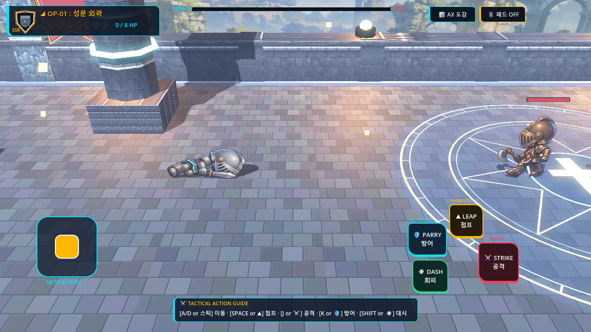
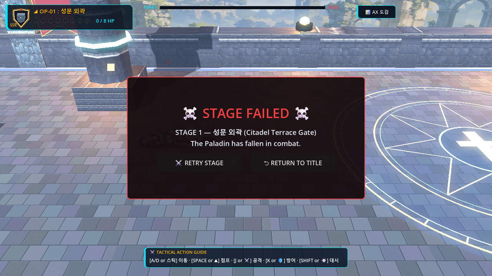
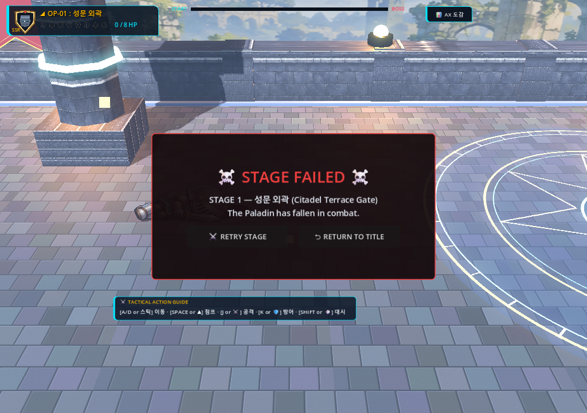
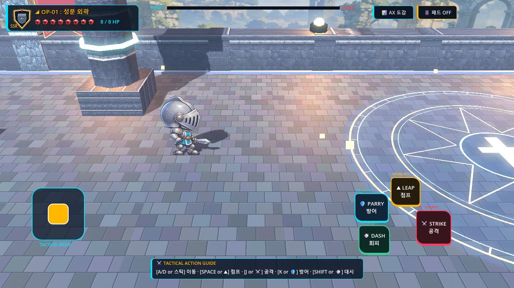
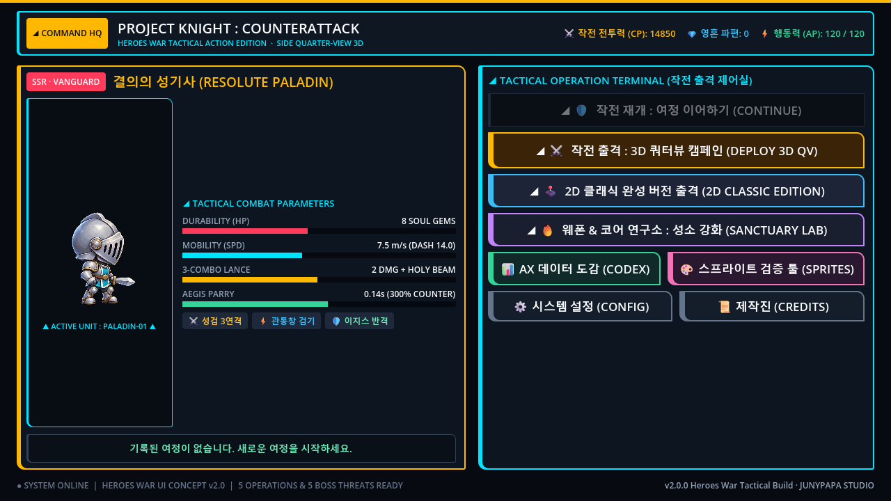

# V3-013 Before vs After Visual & Defeat Recovery Flow Comparison

## Milestone Scope & Quality Target
Milestone **V3-013** focused on **Player-Controlled Defeat, Retry & Campaign Recovery**:
1. Replaced legacy uncontrolled 2.0s automatic stage reload with a dedicated, readable **Stage Failed** overlay (`StageFailedOverlay` & `StageFailedPanel`).
2. Implemented responsive, accessible **Retry Stage** (`RetryStageButton`) and **Return to Title** (`ReturnTitleButton`) action controls.
3. Guaranteed pixel-perfect dialog centering and touch responsiveness across desktop and mobile aspect ratios (1280×720 and 1024×720) without panel clipping or button overlap.
4. Neutralized player combat inputs and disabled enemy attack area monitoring during defeat without global pausing (`get_tree().paused = false`), ensuring clean UI event processing.
5. Preserved campaign stage progression on retry: clicking Retry reloads only the current failed stage with a fresh instance while keeping prior cleared stages intact in `cleared_stages`. Returning to title cleans up state and audio buses.

---

## 1. Defeat Flow: Legacy Auto-Reload vs Player-Controlled Overlay

| Baseline (Before) | Improved (After: 1280×720) |
| :--- | :--- |
|  |  |
| **Observation**: When the player's HP reached 0, the screen simply hung for 2 seconds with active touch controls still visible and active enemies continuing to attack the player's corpse. The stage then abruptly reloaded without player permission or choice. | **Observation**: On player death, virtual touch controls are instantly hidden and released, active enemy attack area monitoring is deferred to false, and a high-readability crimson-themed `StageFailedPanel` is displayed with "작전 실패 (Stage Failed)" header, clear retry prompt, and two distinct primary action buttons ("다시 도전" & "타이틀로"). |

---

## 2. Multi-Resolution & Responsive Viewport Centering

| 1280×720 Landscape | 1024×720 Compact Aspect |
| :--- | :--- |
|  |  |
| **Observation**: Standard 16:9 target resolution. Panel is centered with generous margins, crisp gold typography, 48px touch targets, and full mouse/touch accessibility. | **Observation**: Compact 4:3 / tablet resolution. `CenterContainer` with `PRESET_FULL_RECT` anchors dynamically centers the panel, maintaining exact button geometry without viewport edge clipping or label wrapping. |

---

## 3. Recovery Paths: Fresh Stage Retry vs Return to Title

| Retry Stage (Fresh Respawn) | Return to Title Screen |
| :--- | :--- |
|  |  |
| **Observation**: Clicking "다시 도전 (Retry)" cleans up the defeat overlay, queues-frees the failed stage, and instantiates a pristine stage instance. The player respawns at full HP at spawn ($X=-8.00, Z=0.00$) with fresh minions and waves, while `cleared_stages` retains all earlier stage completion flags. | **Observation**: Clicking "타이틀로 (Return to Title)" cleans up campaign nodes, resets defeat state, stops active stage SFX, and cleanly loads `TitleScreen.tscn`. The player can inspect credits, options, or click "작전 개시 (Deploy)" to start a new campaign. |

---

## Summary of Verification
- Baseline and after captures rendered via hardware OpenGL3 on RTX 5060 Laptop GPU.
- Visual QA confirmed zero UI clipping, zero Z-plane depth fighting ($Z = 0.0000, v_z = 0.0000$), and immediate focus grab on the Retry button for gamepads and keyboards.
- Complete defeat-retry-clear lifecycle verified through real engine input simulation in `v3_013_failure_retry_smoke.gd`.
