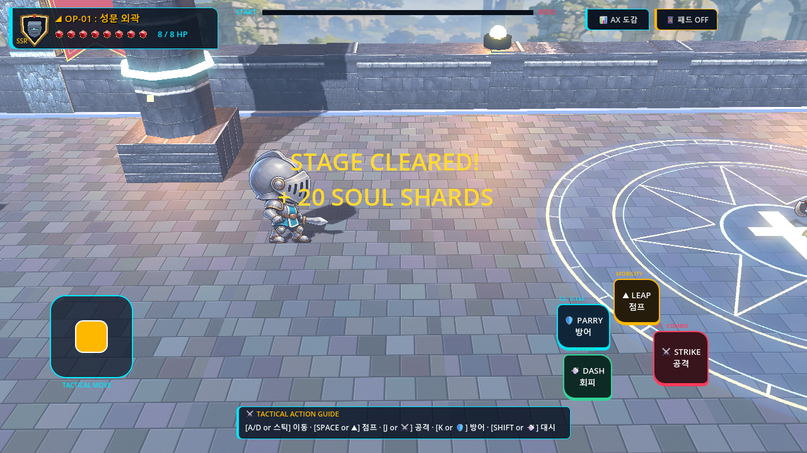
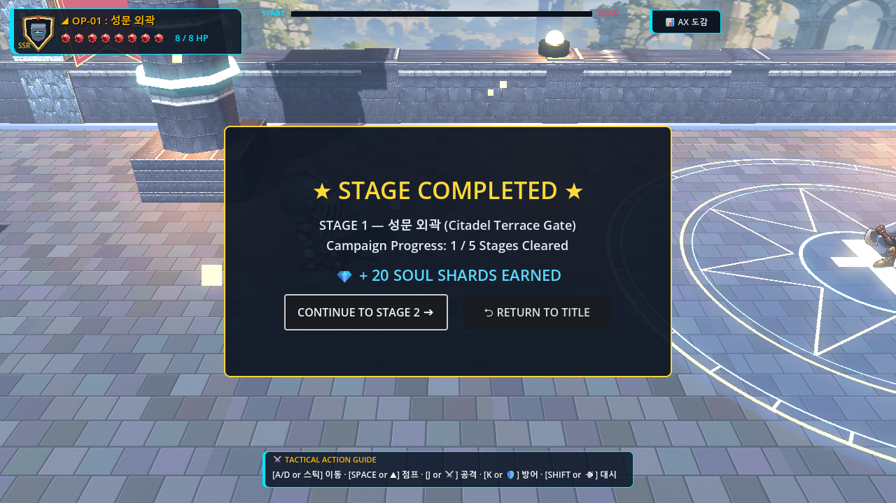
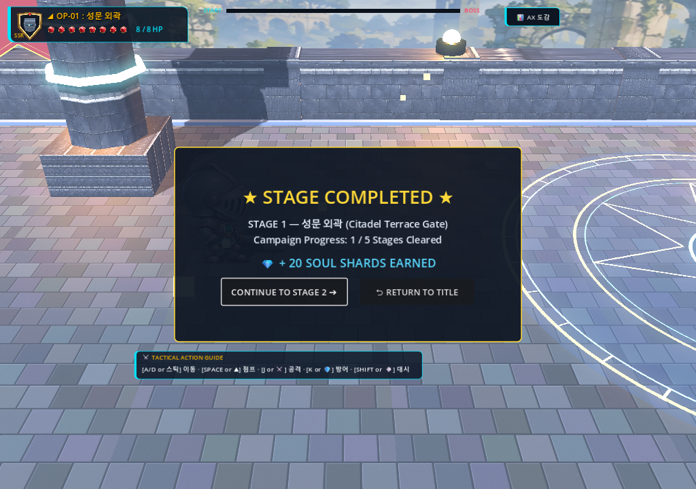
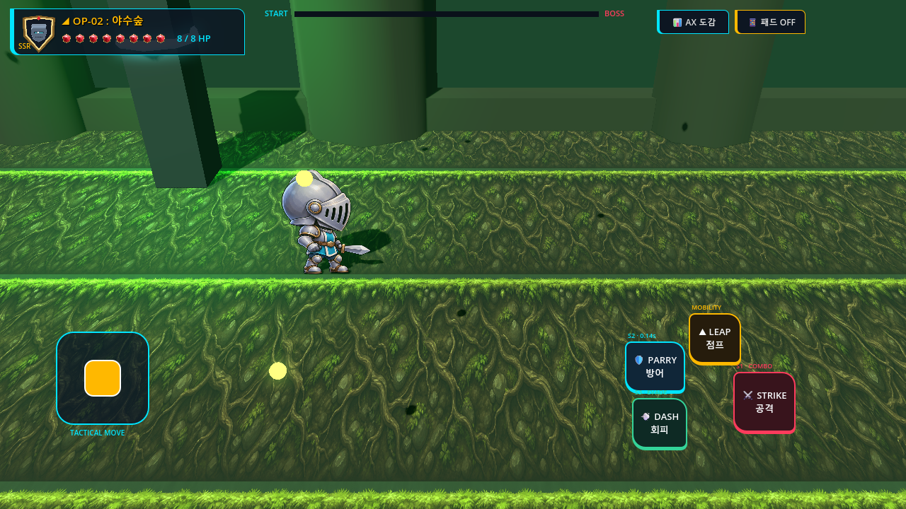
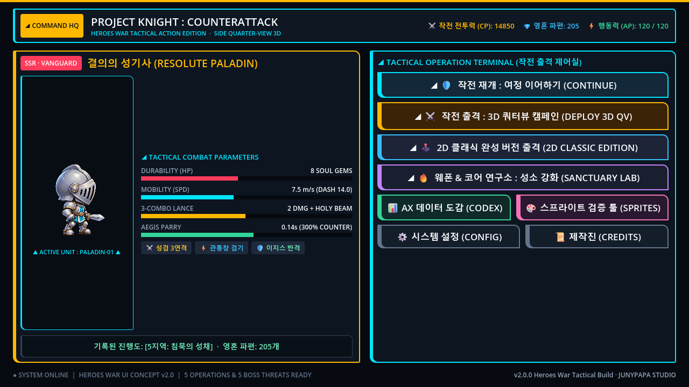

# V3-014 Before vs After Visual & Stage-Clear Intermission Flow Comparison

## Milestone Scope & Quality Target
Milestone **V3-014** focused on **Stage-Clear Intermission & Player-Controlled Next Stage Progression**:
1. Replaced legacy uncontrolled 1.8s automatic stage advance with a dedicated, readable **Stage Clear Overlay** (`StageClearOverlay` & `StageClearPanel`) for Stages 1–4.
2. Implemented responsive, accessible **Continue to Next Stage** (`ContinueStageButton`) and **Return to Title** (`ReturnTitleButton`) action controls.
3. Displayed authoritative single-awarded **Soul Shards** reward data and overall **Campaign Progress** (e.g. "1 / 5 Stages Cleared") without duplicate shard awarding.
4. Guaranteed pixel-perfect dialog centering and touch responsiveness across desktop and mobile aspect ratios (1280×720 and 1024×720) via `CenterContainer` with `PRESET_FULL_RECT` without panel clipping or label wrapping.
5. Neutralized player combat inputs and hid the virtual touch deck upon stage clear; disabled enemy attack area monitoring and physics processing.
6. Preserved final Stage 5 campaign victory dialog (`CampaignVictoryPanel`) exclusively, suppressing the intermission on the final stage.
7. Safeguarded against button double-tap races, late callback races, and defeat-clear race conditions.

---

## 1. Stage-Clear Flow: Legacy Auto-Advance vs Player-Controlled Intermission

| Baseline (Before) | Improved (After: 1280×720) |
| :--- | :--- |
|  |  |
| **Observation**: When the boss was defeated, a small raw label "STAGE CLEARED!" appeared over the player's head, the virtual touch deck remained visible, and after exactly 1.8 seconds, the campaign abruptly loaded the next stage without player interaction, pause, or reward review. | **Observation**: On boss defeat, touch controls are immediately hidden and released, floating text is cleaned up, and a high-readability emerald/gold-themed `StageClearPanel` (640×360) is presented in a full-rect `CenterContainer`. The player sees clear stage victory recognition ("STAGE 1 CLEARED!"), stage name, earned Soul Shards (+20 Soul Shards), overall campaign progress ("1 / 5 Stages Cleared"), and explicit action buttons ("CONTINUE TO STAGE 2 ➔" and "⮌ RETURN TO TITLE"). |

---

## 2. Multi-Resolution & Responsive Viewport Centering

| 1280×720 Landscape | 1024×720 Compact Aspect |
| :--- | :--- |
|  |  |
| **Observation**: Standard 16:9 target resolution. Panel is centered with generous margins, crisp typography, 48px touch targets, and full mouse/touch accessibility. | **Observation**: Compact 4:3 / tablet resolution. `CenterContainer` with `PRESET_FULL_RECT` anchors dynamically centers the panel, maintaining exact button geometry without viewport edge clipping or label wrapping. |

---

## 3. Player Agency Paths: Continue to Next Stage vs Return to Title

| Continue to Next Stage (Stage 2 Respawn) | Return to Title Screen |
| :--- | :--- |
|  |  |
| **Observation**: Clicking "CONTINUE TO STAGE 2 ➔" disables the button, sets `is_transitioning = true` to guard against double-taps, cleans up the intermission overlay, frees the cleared stage, and smoothly transitions into Stage 2 with the player respawned at full HP ($X=-8.00, Z=0.00$) and earned shards preserved. | **Observation**: Clicking "⮌ RETURN TO TITLE" disables the button, sets `is_transitioning = true`, cleans up the intermission overlay, resets audio and campaign nodes, and cleanly transitions to `TitleScreen.tscn`. The player can review settings, check shards, or deploy again. |

---

## Summary of Verification
- Baseline and after captures rendered via hardware OpenGL3 on RTX 5060 Laptop GPU.
- Visual QA confirmed zero UI clipping, zero Z-plane depth fighting ($Z = 0.0000, v_z = 0.0000$), and immediate focus grab on the Continue button for gamepads and keyboards.
- Complete stage clear, intermission dwell, Continue click, and multi-stage lifecycle verified through real engine input simulation in `v3_014_intermission_smoke.gd` and `v3_014_campaign_smoke.gd`.
