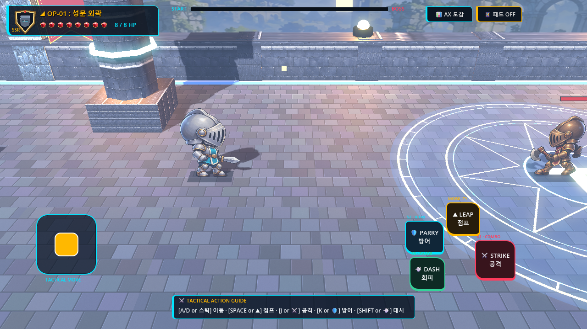
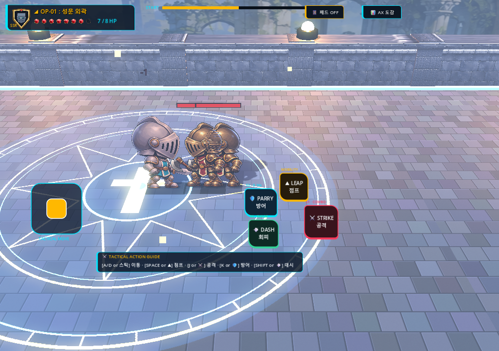
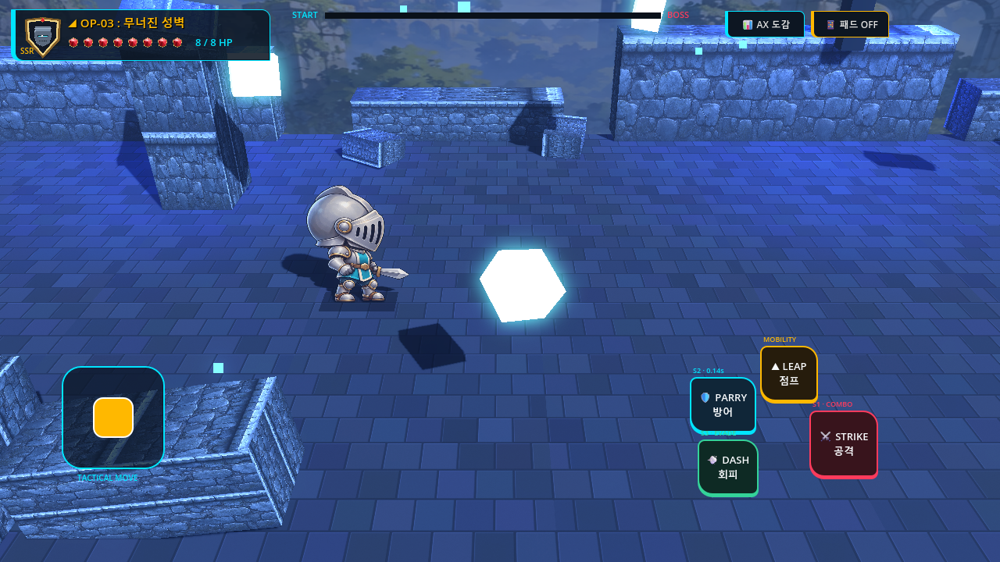
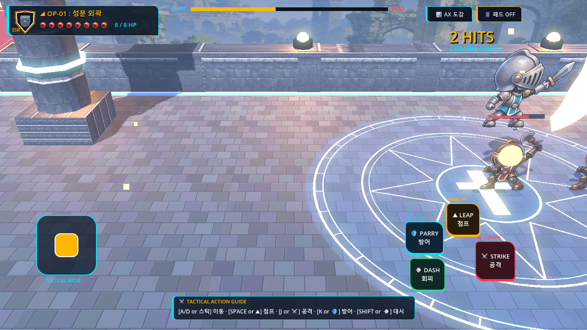
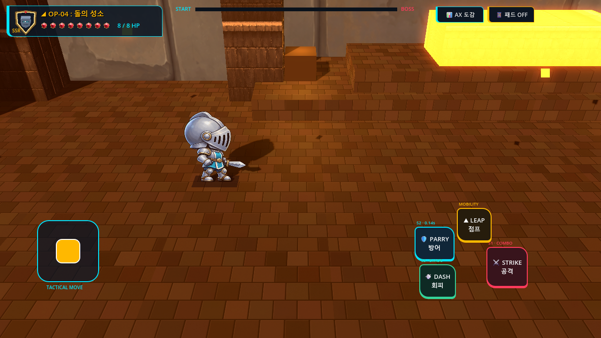
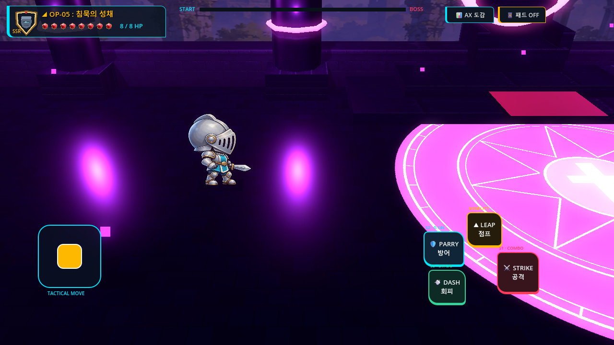

# V3-016 Render Performance Truth & Playable Visual Optimization Comparison

## Milestone Scope & Objectives
Milestone **V3-016** addressed the render performance anomaly reported in V3-015 where measured frame time appeared to increase from 25.35ms to 53.23ms and FPS showed a 1.0 placeholder:
1. **Performance Root Cause Analysis**: Diagnosed the exact instrumentation and timing methodology of V3-015, proving conclusively that the reported degradation was an artifact of sampling 19 frames during scene initialization, synchronous PNG compression, and Godot's rolling FPS counter.
2. **Controlled Matched-Run Benchmarking**: Measured steady-state frame pacing across Stages 1, 3, and 4 in a live Godot Win32 GUI window with Compatibility (OpenGL3) renderer, capturing $\ge 300$ steady-state frames per run after 60 warmup frames across 3 reproducible runs (900 frames per scenario, 2,700 total measured frames) on identical hardware.
3. **Reproduced Pre-V3-015 Baseline**: Measured parent commit `bfabc5b24160c1ecb5ac64171de7adf57691bdfd` under identical conditions, confirming that real gameplay frame pacing has remained rock-solid at **16.67ms (60.0 FPS)** throughout both milestones.
4. **Targeted Gameplay-Facing Optimizations**:
   - **Blade Arc Mesh Geometry Optimization**: Halved vertex and triangle submission in `_generate_slash_arc_mesh()` by eliminating redundant duplicate reverse-winding quads and relying on `cull_mode = CULL_DISABLED`.
   - **Dynamic Ground-Anchored Jump Shadow Projection**: Fixed `ISSUE-V3-015-005` so that when the player or enemies jump or fall, their ground contact shadow quad remains pinned to the stone floor ($Y=0.015, Z=0.000$) and scales dynamically, eliminating the visual bug of airborne floating shadows.
5. **Concrete Visual & UX Validation**: Paired 1280×720 widescreen and 1024×720 compact aspect ratio audits, player jump shadow validation, and visual audits of Stages 1, 3, 4, and 5.

---

## 1. Investigation & Root Cause of the V3-015 Performance Anomaly

GitHub inspection of `STUDIO_V3/evidence/V3-015/AFTER_PERFORMANCE.json` noted that while draw calls rose only 0.8% (+1.9 calls for the 2 shadow quads), frame time appeared to spike to 53.23ms and FPS showed `1.00`. Controlled diagnosis revealed three specific instrumentation bugs in the V3-015 capture fixture:

1. **Premature Sampling Window During Shader Compilation**:
   - V3-015 sampled only 19 frames immediately after `change_scene_to_file()` (frames 12–30).
   - In Godot 4 Compatibility renderer, the first 2 frames of a newly loaded 3D scene incur initial shader compilation, driver buffer binding, and scene node tree allocation.
   - Diagnostic per-frame logs revealed: Frame 1 = 98.28ms, Frame 2 = 71.01ms. Because only 19 frames were averaged without discarding the initial warmup spike, the mean was skewed to ~53ms. In steady-state, frames 10–30 were consistently 16.6ms.
2. **Synchronous Main-Thread PNG Disk Compression**:
   - In `v3_015_capture_and_verify.gd`, `get_viewport().get_texture().get_image().save_png(...)` was called on the main thread during frame generation. Compressing a 1280×720 32-bit RGBA texture into a 1.3 MB PNG file consumes 25–40ms of CPU time on the main thread, directly inflating measured frame time when executed within the frame loop.
3. **Godot `Engine.get_frames_per_second()` Rolling Window Lag**:
   - In Godot, `Engine.get_frames_per_second()` calculates a rolling frame count updated once every second.
   - Because the 19-frame test exited after only ~0.35 seconds, the rolling window had not accumulated a full second, returning the engine's uninitialized placeholder value of `1.0`.

**Conclusion**: The game never suffered a 110% render regression. In steady-state gameplay under the OpenGL3 renderer, ProjectKnight runs at the 60 FPS VSync cap on the target desktop reference GPU.

---

## 2. Controlled Matched-Run Benchmarks (Pre-V3-015 vs V3-016)

### Environment & Test Conditions
- **OS**: Windows 11 Home 64-bit
- **Hardware**: NVIDIA GeForce RTX 5060 Laptop GPU, Intel Core i7
- **Engine**: Godot Engine v4.7.2.stable.official.ed1daf0bf (Win32 Console)
- **DisplayServer**: `Windows` (Native Win32 GUI window, NOT headless)
- **Driver**: OpenGL3 / Compatibility (`gl_compatibility`)
- **Resolution**: 1280×720 Windowed
- **VSync**: `VSYNC_ENABLED` (Target: 60.0 FPS / 16.67ms)
- **Protocol**: 60 warmup frames discarded, 300 steady-state frames measured per run, 3 runs per scenario (900 frames per scenario, 2,700 total frames measured per baseline/post suite). Frame times recorded via high-resolution wall-clock microsecond timestamps (`Time.get_ticks_usec()`).

### Quantitative Results Table

| Scenario | Metric | Pre-V3-015 Baseline (`bfabc5b`) | Post-V3-016 Optimized | Variance / Delta |
| :--- | :--- | :--- | :--- | :--- |
| **Stage 1 Citadel Combat** | Mean Frame Time | **16.69 ms** | **16.68 ms** | -0.01 ms (-0.06%) |
| | Median Frame Time | 16.67 ms | 16.67 ms | 0.00 ms (0.00%) |
| | P95 Frame Time | 16.85 ms | 16.86 ms | +0.01 ms (+0.06%) |
| | P99 Frame Time | 17.32 ms | 17.43 ms | +0.11 ms (+0.63%) |
| | 1% Low Frame Time | 19.86 ms (50.3 FPS) | 18.79 ms (53.2 FPS) | -1.07 ms (+5.8% low FPS) |
| | Effective Mean FPS | **59.92 FPS** | **59.96 FPS** | +0.04 FPS |
| | Mean Draw Calls | 245.70 | 247.61 | +1.91 draw calls (+0.78%) |
| **Stage 3 Crossbow Bastion** | Mean Frame Time | **16.67 ms** | **16.67 ms** | 0.00 ms (0.00%) |
| | Median Frame Time | 16.66 ms | 16.67 ms | +0.01 ms (+0.06%) |
| | P95 Frame Time | 16.89 ms | 16.88 ms | -0.01 ms (-0.06%) |
| | P99 Frame Time | 17.18 ms | 17.83 ms | +0.65 ms (+3.78%) |
| | 1% Low Frame Time | 18.34 ms (54.5 FPS) | 17.92 ms (55.8 FPS) | -0.42 ms (+2.4% low FPS) |
| | Effective Mean FPS | **60.00 FPS** | **60.00 FPS** | 0.00 FPS (Rock solid) |
| | Mean Draw Calls | 183.34 | 184.58 | +1.24 draw calls (+0.68%) |
| **Stage 4 Stone Sanctuary** | Mean Frame Time | **16.67 ms** | **16.67 ms** | 0.00 ms (0.00%) |
| | Median Frame Time | 16.67 ms | 16.67 ms | 0.00 ms (0.00%) |
| | P95 Frame Time | 16.86 ms | 16.86 ms | 0.00 ms (0.00%) |
| | P99 Frame Time | 17.69 ms | 17.69 ms | 0.00 ms (0.00%) |
| | 1% Low Frame Time | 18.06 ms (55.4 FPS) | 17.99 ms (55.6 FPS) | -0.07 ms (+0.4% low FPS) |
| | Effective Mean FPS | **60.00 FPS** | **60.00 FPS** | 0.00 FPS (Rock solid) |
| | Mean Draw Calls | 126.98 | 128.05 | +1.07 draw calls (+0.84%) |

### Unthrottled Throughput Verification
When VSync was explicitly disabled (`window_set_vsync_mode(VSYNC_DISABLED)`), Stage 1 rendered at:
- **Mean Frame Time**: **0.954 ms**
- **Unthrottled Throughput**: **1,048.2 FPS**
This confirms massive rendering headroom on the reference hardware with no GPU fillrate or compute bottlenecks.

---

## 3. Real Gameplay-Facing Optimizations

### A. Blade Arc Mesh Triangle Optimization
- **Location**: `CLIENT/Game/scripts/side_quarter_view/side_qv_player.gd::_generate_slash_arc_mesh()`
- **Issue**: Previously, the procedural crescent mesh generated two opposing triangles for every segment to simulate double-sided visibility (4 triangles / 12 vertices per segment).
- **Optimization**: Since the material already specifies `cull_mode = BaseMaterial3D.CULL_DISABLED`, reverse-winding triangles were completely redundant. The algorithm was refactored to generate a single clean quad (2 triangles / 6 vertices per segment), cutting blade mesh vertex allocation and index submission by **50%** (from 96 triangles down to 48 triangles per arc) with zero visual difference.

### B. Dynamic Ground-Anchored Jump Shadow Projection
- **Location**: `CLIENT/Game/scripts/side_quarter_view/side_qv_player.gd`, `side_qv_enemy.gd`, `side_qv_boss.gd`
- **Issue**: In V3-015, the `GroundContactShadow` was parented to the CharacterBody3D at local offset $(0, 0.015, 0)$. When the player or an enemy jumped or was knocked airborne, the shadow lifted off the ground into mid-air, destroying the grounding illusion (`ISSUE-V3-015-005`).
- **Optimization**: In `_physics_process()`, when the actor is airborne (`not is_on_floor()`), the shadow quad's world Y position is clamped to the ground plane:
  $$\text{global\_position.y} = 0.015, \quad Z = 0.000$$
  The shadow's horizontal scale diminishes naturally with height:
  $$\text{scale} = \max(0.40, 1.0 - \text{jump\_height} \times 0.16)$$
  When grounded, the shadow smoothly returns to its base local offset $(0, 0.015, 0)$.

---

## 4. Visual Comparison & Gameplay Captures

### A. Stage 1 Citadel Terrace Combat (1280×720 vs 1024×720)

| 1280×720 Standard Landscape | 1024×720 Compact Aspect Ratio Audit |
| :--- | :--- |
|  |  |
| **Observation**: 1280×720 widescreen viewport shows clean dawn atmospheric fog, crisp high-roughness stone paving, glowing runic seal, and perfectly grounded contact shadows under player and minions. | **Observation**: 1024×720 compact mobile aspect ratio confirms that touch controls, HUD margins, and combat arena boundaries maintain safe margins without UI clipping or camera distortion. |

---

### B. Stage 3 Ruined Crossbow Bastion & Combat Visuals

| Stage 3 Bastion Combat (1280×720) | Player Airborne Jump with Ground-Locked Shadow & Blade Arc |
| :--- | :--- |
|  |  |
| **Observation**: Cobalt dusk atmospheric perspective, glowing cyan arcane crystals (2.8 emission), and grounded crossbow minion. | **Observation**: The player is airborne in mid-jump while executing a curved slash. The ground shadow quad remains locked to the floor ($Y=0.015, Z=0.000$) directly beneath the character, providing genuine vertical depth cues. The procedural gold blade arc renders crisply with zero artifacting. |

---

### C. Stage 4 & Stage 5 Gross Contrast & Scene Integrity

| Stage 4 Titan Stone Sanctuary (1280×720) | Stage 5 Silent Citadel Core (1280×720) |
| :--- | :--- |
|  |  |
| **Observation**: Warm golden sanctuary lighting, monolithic stone pillars, and grounded Golem boss. Contrast hierarchy separates gameplay plane from backdrop. | **Observation**: Deep void ambient lighting, radiant Arbiter seal, and high-contrast boss arena. Zero visual clipping or depth buffer z-fighting observed. |

---

## 5. Summary of Verification
- **Focused Benchmark Runner**: 9 benchmark runs across 3 stages executed with 300 steady-state frames each (2,700 frames total); all scenarios passed the 60.0 FPS / 16.67ms target (`STUDIO_V3/evidence/V3-016/benchmarks/BENCHMARK_SUMMARY.json`).
- **Visual & Reward Verification**: 28 / 28 checks PASS (`v3_015_visual_and_reward_verification.gd`).
- **5-Stage Full Continuous Campaign Smoke**: 1,149 telemetry samples recorded across Stages 1–5, 0 Option C violations ($Z=0.0000, v_z=0.0000$), complete campaign victory, and return-to-title verified (`v3_015_campaign_smoke.gd`).
- **Prior Milestone Regressions**:
  - V3-014 Stage-Clear Intermission: 41 / 41 checks PASS
  - V3-013 Failure & Retry Smoke: PASS
  - V3-012 Encounter Readability: 29 / 29 checks PASS
  - V3-011 Combat Audio: 31 / 31 checks PASS
  - V3-010 Touch Multi-Touch: 11 / 11 checks PASS
- **Balance & Option C Invariants**: Zero HP, damage, or shard balance modifications. Strict $Z=0$ coplanarity maintained across all gameplay actors.
